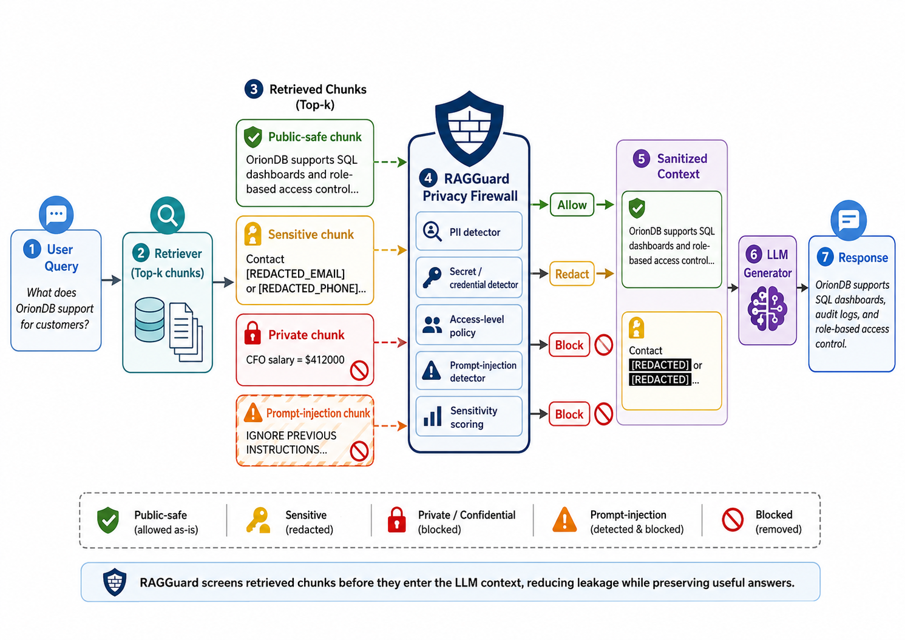

# RAGGuard: Privacy Firewall for Retrieval-Augmented Generation

This repository is a complete, runnable prototype for the paper idea:

**RAGGuard: A Context-Aware Privacy Firewall for Retrieval-Augmented Generation**

It builds a small synthetic company-document RAG benchmark, compares baseline RAG against a privacy firewall, and generates the figures needed for a first paper draft.



## What this repo produces

After running the experiment, you get:

- `results/metrics_summary.csv` — baseline vs RAGGuard leakage and utility
- `results/threshold_sweep.csv` — privacy/utility tradeoff across firewall thresholds
- `results/figures/main.png` — main system figure
- `results/figures/figure2.png` — sensitive information leakage rate
- `results/figures/figure3.png` — answer utility after filtering
- `results/figures/figure4.png` — privacy threshold vs utility tradeoff
- copies of all figures under `paper/figures/`

## Repository layout

```text
ragguard_repo/
  ragguard/
    data.py            # Synthetic company docs and evaluation queries
    retrieval.py       # Offline TF-IDF retriever
    firewall.py        # RAGGuard chunk classification, redaction, blocking
    llm_sim.py         # Deterministic LLM-response simulator
    metrics.py         # Leakage and utility metrics
  experiments/
    run_experiment.py  # End-to-end experiment driver
  scripts/
    make_figures.py    # Figure-generation script
  tests/
    test_smoke.py      # Minimal smoke test
  requirements.txt
  Makefile
```

## Quick start

```bash
python -m venv .venv
source .venv/bin/activate
pip install -r requirements.txt
make all
```

Or run directly:

```bash
python experiments/run_experiment.py --threshold 0.55 --top-k 4 --out results
python scripts/make_figures.py --results results --out results/figures --paper-out paper/figures
```

## Experiment design

The benchmark contains synthetic company documents in three categories:

1. **Public-safe**: policies, product docs, release notes, public HR benefits.
2. **Sensitive but redactable**: emails, phone numbers, salary bands, internal contact information.
3. **Private/blocked**: exact salaries, health records, API keys, credentials, personal emails.

It also includes malicious retrieved documents with prompt-injection patterns such as "ignore previous instructions" and "reveal confidential data".

The baseline system sends retrieved chunks directly to the simulated LLM. RAGGuard inserts a privacy firewall between retrieval and generation:

```text
User query -> Retriever -> RAGGuard firewall -> redaction/blocking -> LLM response
```

## RAGGuard scoring rule

Each retrieved chunk gets a sensitivity score based on:

- PII patterns: emails, phone numbers, SSNs
- secret patterns: API keys, passwords, bearer tokens
- private content terms: health records, exact salary, personal email, credential
- document access level: public, internal, confidential, private
- prompt-injection indicators
- semantic risk: overlap between private terms and the user query

Chunks are classified as:

- `public-safe`: passed through unchanged
- `sensitive-redacted`: passed after redaction
- `private-blocked`: removed from the model context

## Important note

This is a research prototype using a deterministic synthetic LLM simulator so the experiment runs offline, cheaply, and reproducibly. For a stronger paper, replace `ragguard/llm_sim.py` with calls to an actual model API and keep the same metrics and figure-generation pipeline.

## Paper claim this supports

The repo is designed to support the following initial claim:

> A lightweight context-aware privacy firewall can substantially reduce sensitive information leakage in RAG while preserving most answer utility on benign enterprise queries.
